# Супер-админ

Одна панель на всю платформу LOTAX. Ниже — пункты левого меню сверху вниз. На скриншотах имена, телефоны, почта и названия организаций заменены.

## Платформа

### Организации

Супер-админ видит всех клиентов в одной таблице: организация, контакт, сколько парков, водителей и поездок, подписка и статус.

Список фильтруется по подписке. Организацию можно создать кнопкой «Создать организацию».

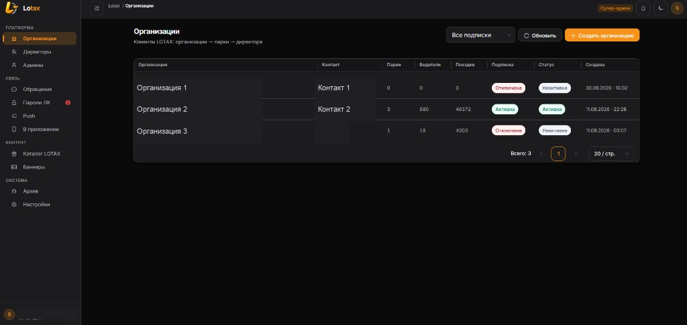

### Карточка организации

В карточке — сводка и реквизиты: название, юридическое имя, телефон, контактное лицо, включена ли организация.

Отсюда подписку отключают, назначают директора или удаляют организацию.

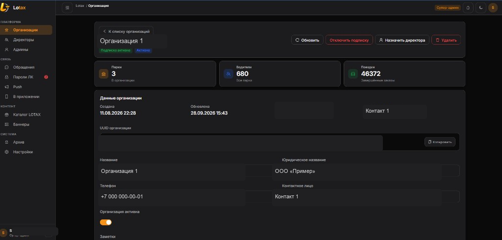

### Парки и сотрудники

В одной организации парков может быть сколько угодно. У каждого парка своя подписка и ключ API. Парк добавляют, меняют и удаляют.

Ниже — сотрудники личного кабинета: директор и менеджеры. Учётную запись можно заблокировать.

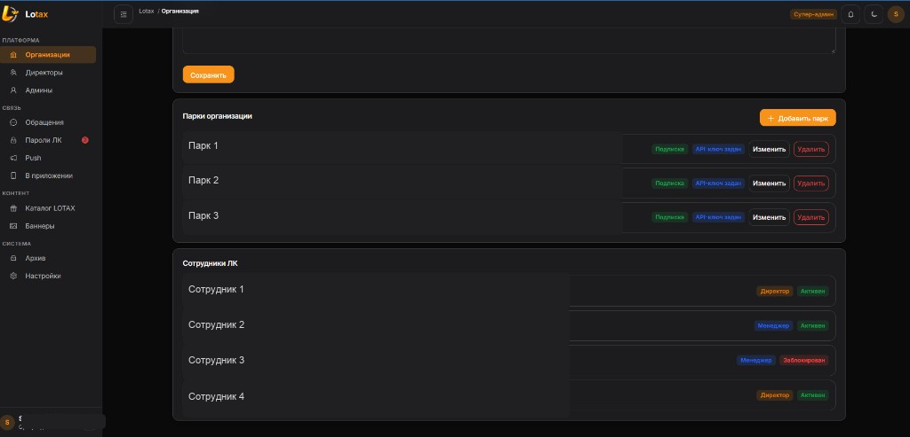

### Директоры

Действующие директора всех организаций. Список обновляется. Пароль директора меняется из его карточки.

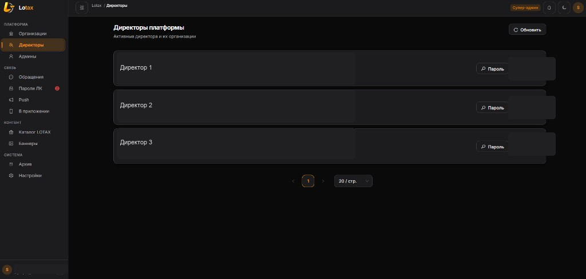

### Админы

Админ платформы видит организации и парки и не видит водителей. Супер-админ добавляет такого админа и задаёт ему пароль.

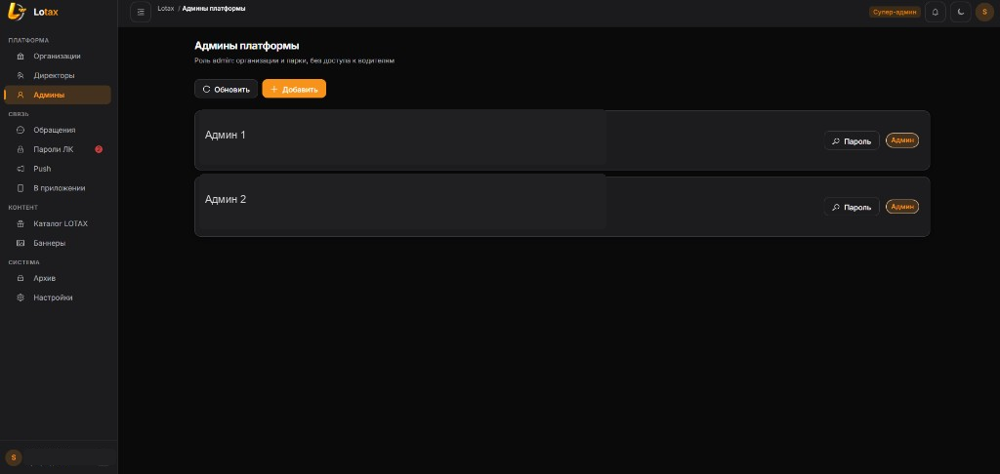

## Связь

### Обращения

Переписка поддержки LOTAX с директорами. Слева список диалогов, справа сообщения. Ответ пишут внизу или отправляют готовую фразу.

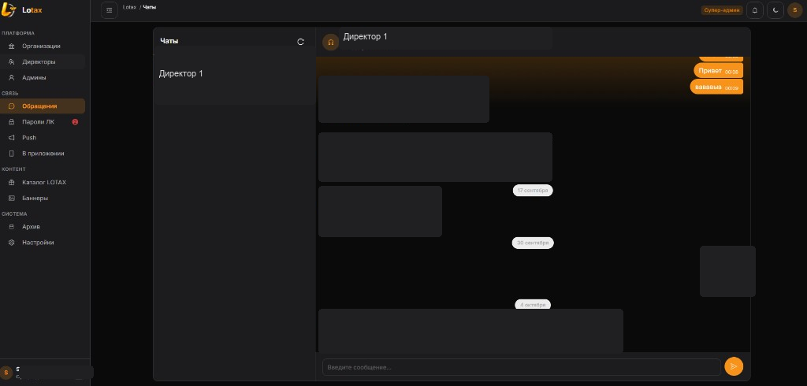

### Пароли ЛК

Заявки на пароль личного кабинета. Вкладки: открытые, закрытые и все. Супер-админ задаёт пароль в диалоге и закрывает комнату.

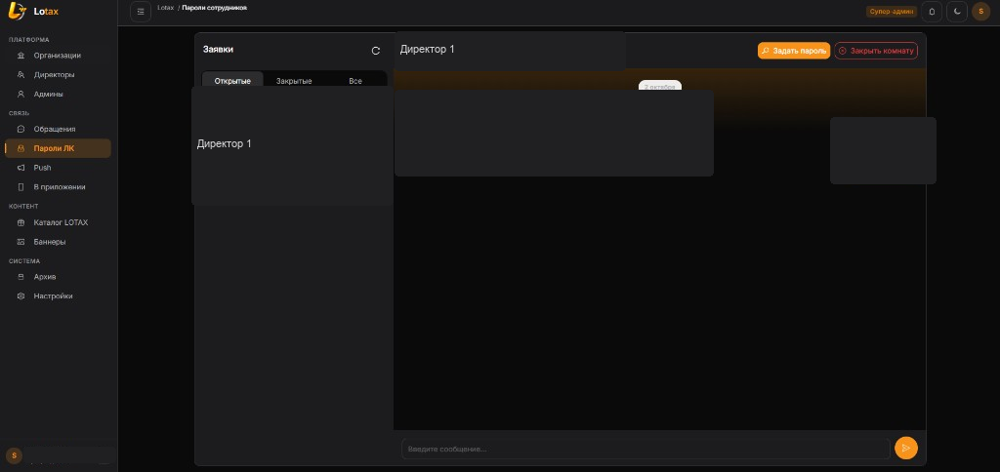

### Push

Рассылка по организациям: напоминание перед розыгрышем и другие сообщения. Push при создании купона уходит с сервера сам. По каждой рассылке видно, сколько устройств получили сообщение и сколько ошибок.

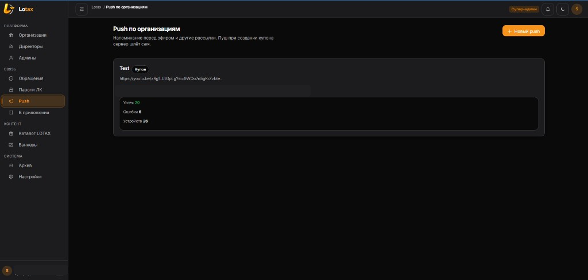

### В приложении

Сколько водителей числится в парках и сколько из них хотя бы раз открыли приложение. Отдельно — за 7 и 30 дней, по организациям и по устройствам: iOS и Android.

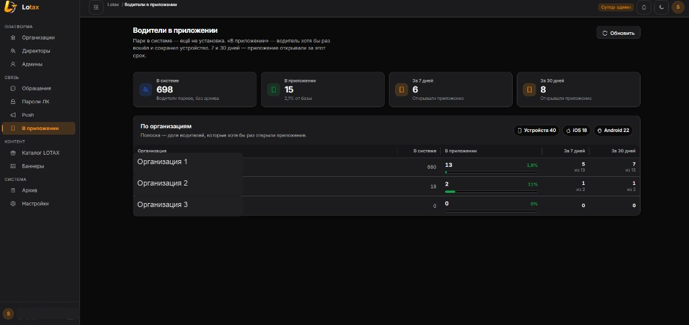

## Контент

### Каталог LOTAX

Награды за системные баллы. Их видят водители всех парков. Награду добавляют и меняют: цена в баллах, тип, запас, дата розыгрыша. Список для рандомайзера скачивается отсюда.

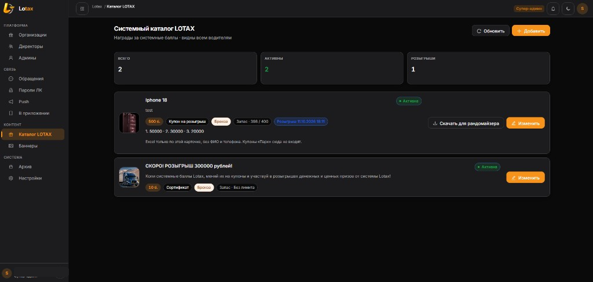

### Баннеры

Реклама в приложении водителя. Чем меньше порядок, тем выше баннер в карусели. У баннера есть аудитория, период и статус.

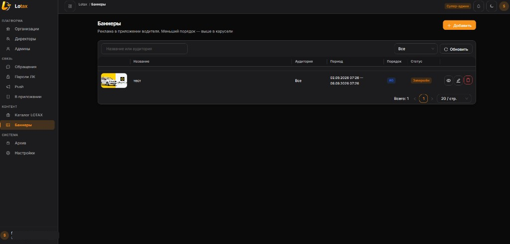

## Система

### Архив

Сюда попадают водители, которых синхрон Яндекса убрал из парка: в парке они уже не «работающие». Аккаунт при этом не удалён.

Восстановление: статус «Ожидание», затем SMS, затем «Активен». Поиск по имени, телефону или парку.

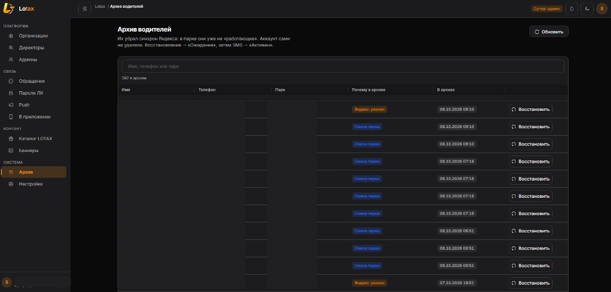

### Настройки

Общие параметры LOTAX. Системные баллы: сколько начислять за час на линии и какой дневной лимит часов. Параметр можно добавить, изменить и удалить.

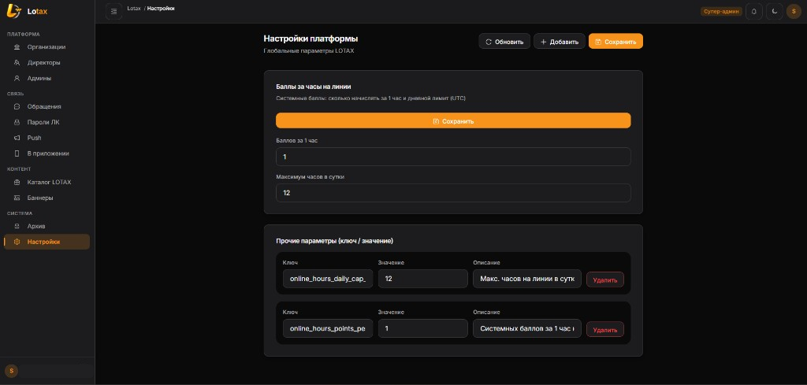

## Профиль

Тема панели: авто, светлая или тёмная. Здесь же почта, имя и статус учётной записи.

Свой пароль меняют на этой странице, не через список сотрудников. Ниже — что доступно роли «Супер-админ».

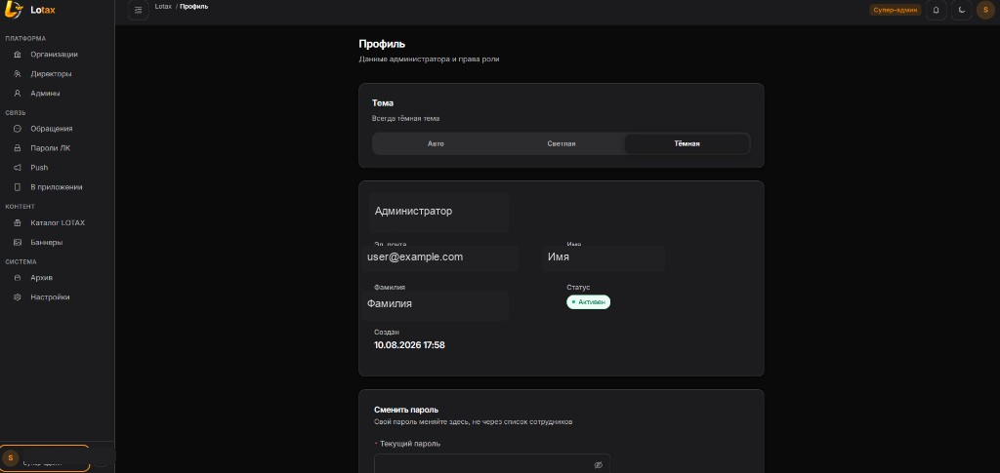

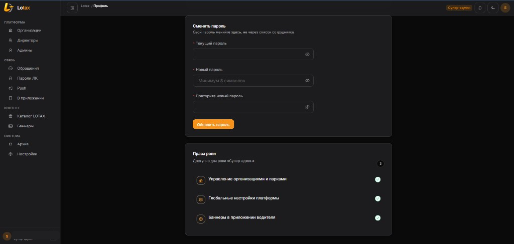
